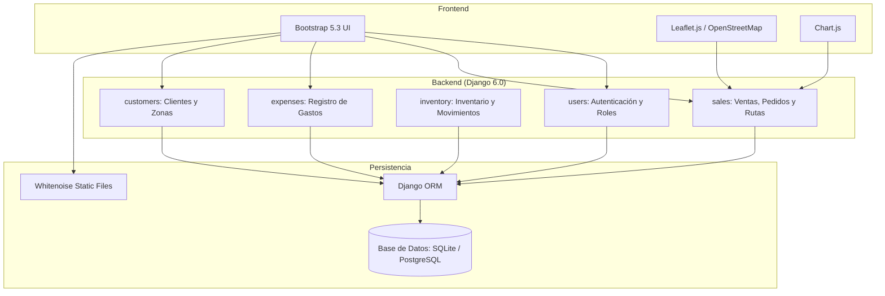

<div align="center">

# 🥚 HUEVO REAL
### Sistema de Gestión Operativa, Inventario y Logística de Distribución

Aplicación web para la administración de ventas, control de inventario multialmacén, optimización de rutas de reparto y análisis financiero para el negocio de distribución avícola.

<br/>

[](https://www.python.org/)
[](https://www.djangoproject.com/)
[](https://getbootstrap.com/)
[](https://leafletjs.com/)
[](https://www.chartjs.org/)

</div>

---

## Tabla de Contenidos

1. [Descripción General](#descripción-general)
2. [Funcionalidades Principales](#funcionalidades-principales)
3. [Arquitectura del Sistema](#arquitectura-del-sistema)
4. [Stack Tecnológico](#stack-tecnológico)
5. [Estructura del Proyecto](#estructura-del-proyecto)
6. [Instalación y Configuración](#instalación-y-configuración)
7. [Reglas de Negocio e Integridad de Datos](#reglas-de-negocio-e-integridad-de-datos)
8. [Roles y Permisos](#roles-y-permisos)
9. [Roadmap](#roadmap)
10. [Licencia](#licencia)

---

## Descripción General

**Huevo Real** es una plataforma web desarrollada en Django para centralizar la operación comercial, la distribución logística y el seguimiento financiero de la venta de huevo al mayoreo y menudeo.

El sistema resuelve las necesidades operativas del día a día:
- **Control de Inventario**: Registro de producción propia, compras a proveedores externos, traspasos entre bodegas y mermas.
- **Rutas de Reparto**: Planificación y ordenamiento geoespacial de entregas a clientes según su ubicación geográfica.
- **Ventas y Cobranza**: Gestión de pedidos individuales y recurrentes, estados de pago (efectivo y transferencia) y saldos pendientes.
- **Métricas y Análisis**: Reportes mensuales de ventas, gastos operativos, utilidad neta y proyecciones de retorno basadas en datos reales.

---

## Funcionalidades Principales

### 1. Logística de Reparto y Optimización de Rutas
- Mapa interactivo con Leaflet.js y OpenStreetMap para visualizar los pedidos del día.
- Cálculo de ruta de entrega más corta ordenando las paradas según la distancia desde el punto de partida (algoritmo del vecino más cercano / TSP).
- Opción de iniciar ruta desde la ubicación GPS del repartidor o desde una bodega fija registrada.
- Identificación de clientes que aún no cuentan con coordenadas registradas para facilitar su captura.

### 2. Inventario Multialmacén y Movimientos
- Control de existencias por ubicación física (bodegas, vehículos o puntos de venta).
- Registro tipificado de movimientos:
  - Producción interna.
  - Compras a proveedores externos.
  - Salidas automáticas vinculadas a ventas completadas.
  - Traspasos entre sucursales/almacenes.
  - Registro de merma y correcciones de inventario.
- Uso de transacciones atómicas (`transaction.atomic`) para asegurar que una venta y su descuento de stock se completen juntos o no se apliquen.

### 3. Ventas y Pedidos Recurrentes
- Venta por kilogramo o por pieza con cálculo automático de importes.
- Módulo de pedidos recurrentes configurables por frecuencia (semanal, quincenal, mensual) y día de entrega.
- Generación por lote de pedidos para el día de reparto seleccionado.
- Conversión de pedidos completados a ventas con actualización inmediata de inventario.
- Seguimiento de estados de pago: Pagado, Parcial o Pendiente.

### 4. Reportes y Panel de Rendimiento
- Resumen mensual de ventas, gastos, utilidades y balance de producto (piezas y kg vendidos vs. producidos).
- Gráficas interactivas de tendencia diaria, métodos de pago y clientes frecuentes.
- Panel de análisis de inversión con cálculo de utilidad promedio, margen neto y simulador de retorno (ROI y meses estimados de recuperación).
- Exclusión automática de meses con datos incompletos para no distorsionar promedios ni márgenes.

### 5. Directorio de Clientes y Zonificación
- Catálogo de clientes con dirección, teléfono, fraccionamiento, zona y coordenadas geográficas (latitud/longitud).
- Historial de compras y notas de entrega por cliente.

---

## Arquitectura del Sistema

El proyecto está estructurado bajo el patrón **MVT (Model-View-Template)** de Django, utilizando Class-Based Views, modelos relacionales y frontend responsivo.



---

## Stack Tecnológico

| Componente | Tecnología | Uso en el Proyecto |
| :--- | :--- | :--- |
| **Backend** | **Django 6.0** | Framework principal, ORM, autenticación y manejo de formularios. |
| **Lenguaje** | **Python 3.12+** | Lenguaje de desarrollo backend. |
| **Base de Datos** | **SQLite / PostgreSQL** | Almacenamiento relacional compatible con el ORM de Django. |
| **Archivos Estáticos**| **Whitenoise 6.11** | Compresión y servicio eficiente de archivos estáticos. |
| **Frontend** | **Bootstrap 5.3.3** | Interfaz responsiva adaptada a dispositivos móviles y escritorio. |
| **Mapas** | **Leaflet.js 1.9.4** | Visualización de mapas y marcadores de entrega con OpenStreetMap. |
| **Gráficos** | **Chart.js** | Gráficas estadísticas en dashboards mensuales y reportes. |
| **Iconos** | **Font Awesome 6** | Iconografía de la interfaz de usuario. |

---

## Estructura del Proyecto

```text
huevoreal/
├── customers/          # Clientes, fraccionamientos, zonas y coordenadas GPS
├── expenses/           # Registro y categorización de gastos operativos
├── inventory/          # Ubicaciones, productos, proveedores y movimientos de stock
├── sales/              # Ventas, pedidos, optimización de rutas y estadísticas
├── users/              # Modelo de usuario personalizado (CustomUser) y roles
├── huevoreal/          # Configuración principal del proyecto y URLs
├── static/             # Archivos CSS personalizados, scripts JS e imágenes
├── templates/          # Plantillas HTML organizadas por aplicación
├── manage.py           # Utilidad de línea de comandos de Django
├── requirements.txt    # Dependencias del proyecto
└── .env.example        # Plantilla de variables de entorno
```

---

## Instalación y Configuración

### Prerrequisitos
- Python 3.12 o superior
- Git
- Gestor de entornos virtuales (`venv`)

### 1. Clonar el Repositorio
```bash
git clone git@github.com:ulisestc/huevoreal-IA-.git
cd huevoreal-IA-
```

### 2. Crear y Activar el Entorno Virtual
```bash
python3 -m venv .venv
source .venv/bin/activate  # En Linux / macOS
# .venv\Scripts\activate   # En Windows
```

### 3. Instalar Dependencias
```bash
pip install -r requirements.txt
```

### 4. Configurar Variables de Entorno
Copiar la plantilla de variables de entorno y definir los valores correspondientes:
```bash
cp .env.example .env
```

| Variable | Descripción | Valor por Defecto |
| :--- | :--- | :--- |
| `SECRET_KEY` | Clave secreta para la sesión criptográfica de Django. | Generar una clave para producción |
| `DEBUG` | Modo depuración (`True` en desarrollo, `False` en producción). | `True` |
| `ALLOWED_HOSTS` | Hosts o dominios permitidos separados por coma. | `127.0.0.1,localhost` |

### 5. Ejecutar Migraciones
```bash
python manage.py migrate
```

### 6. Crear Usuario Administrador
```bash
python manage.py createsuperuser
```

### 7. Recolectar Archivos Estáticos
```bash
python manage.py collectstatic --noinput
```

### 8. Iniciar el Servidor de Desarrollo
```bash
python manage.py runserver
```
La aplicación estará disponible en: [http://127.0.0.1:8000](http://127.0.0.1:8000)

---

## Reglas de Negocio e Integridad de Datos

- **Cifras reales**: Todos los datos que muestran los dashboards y reportes provienen directamente de registros en base de datos; no se utilizan valores simulados.
- **Descuento atómico de existencias**: Al confirmar una venta o completar un pedido, el movimiento de inventario se procesa dentro de una transacción atómica para evitar descuadres.
- **Consistencia en cálculos financieros**: Los promedios y márgenes de utilidad en los análisis históricos consideran únicamente los meses que cuentan con registros tanto de ingresos como de egresos.
- **Diseño pensado para uso en campo**: Formularios con tamaño de letra mínimo de 16px para evitar zoom involuntario en teléfonos móviles y tablas con desplazamiento horizontal.

---

## Roles y Permisos

El sistema utiliza un modelo de usuario extendido (`CustomUser`) con dos perfiles de acceso:

- **Admin Maestro (`ADMIN`)**: Acceso completo al sistema, configuración de catálogos, reportes financieros, estadísticas y administración general.
- **Vendedor (`VENDEDOR`)**: Acceso enfocado en la operativa de campo: registro de ventas diarias, consulta de pedidos asignados, ruteo de entrega y consulta de existencias.

---

## Roadmap

- [ ] Generación y descarga de comprobantes en PDF.
- [ ] Integración con servicio de mensajería (WhatsApp / SMS) para notificaciones de entrega.
- [ ] Exportación de reportes a formatos Excel / CSV.
- [ ] Modo sin conexión para captura de pedidos en zonas con baja conectividad.

---

## Licencia

Este proyecto y su código fuente son de uso privado y confidencial para **Huevo Real**.
